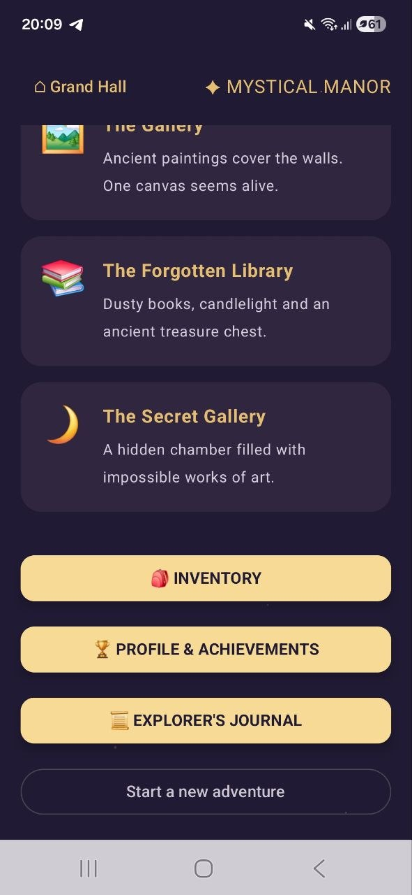
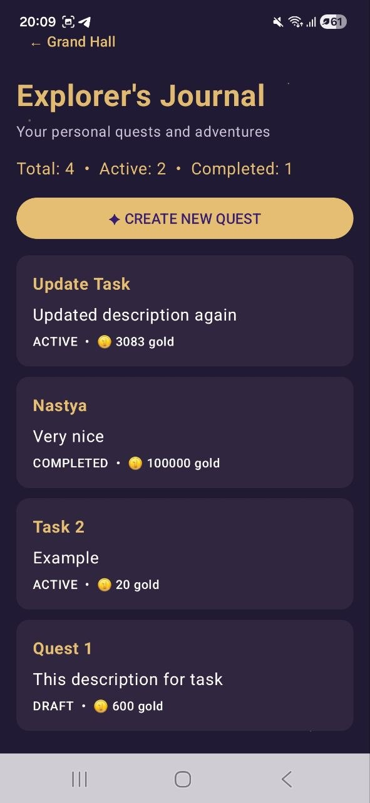
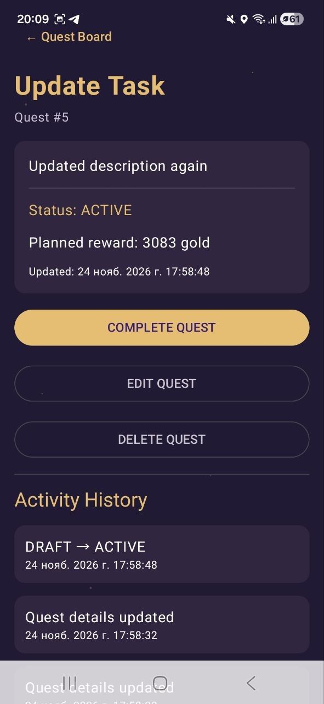
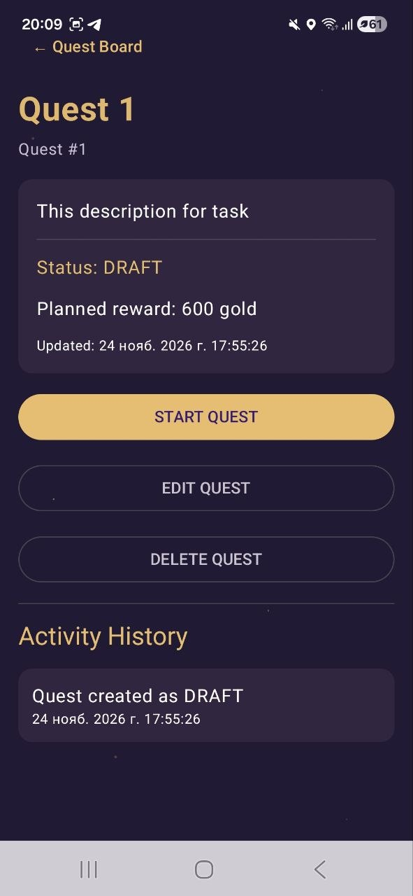
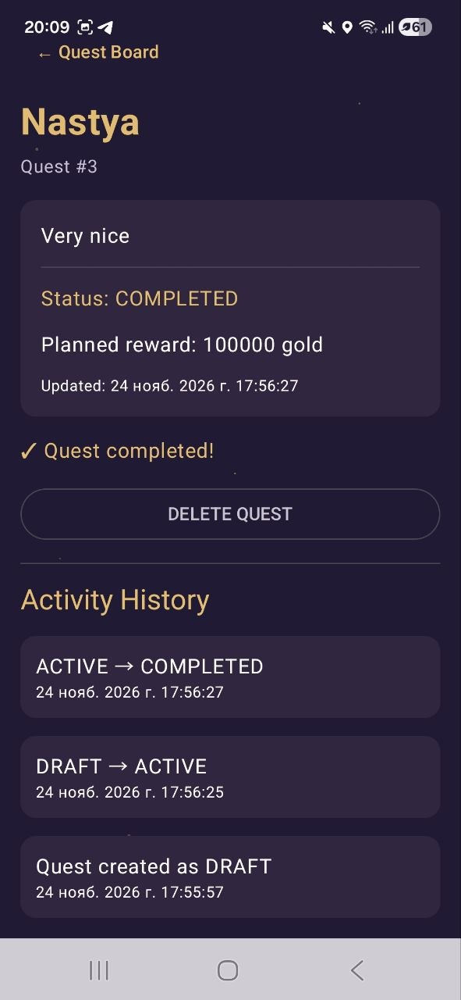
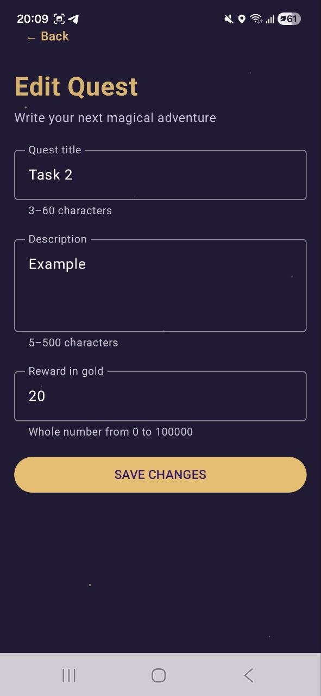
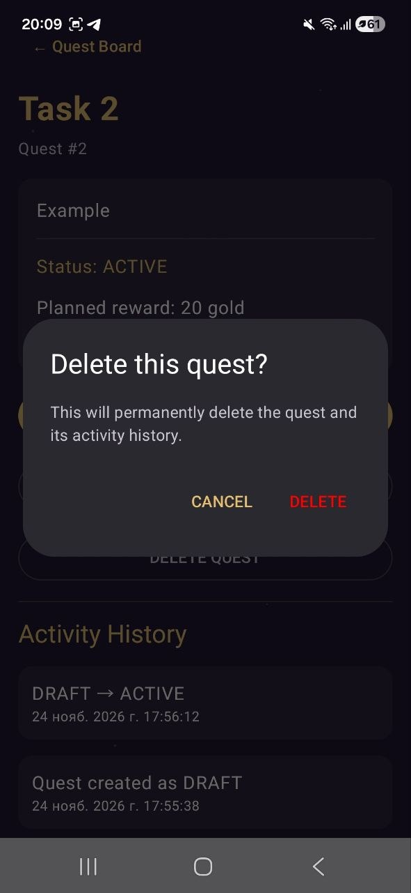

# 🏰 Mystical Manor Adventure

**A magical Android adventure built with Kotlin, Jetpack Compose, MVVM, and Room.**


---

## ✨ About the Project

**Mystical Manor Adventure** is an interactive fantasy game where players explore a mysterious mansion, discover magical paintings, battle supernatural enemies, collect treasures, and unlock achievements.

The application was developed and extended across three Android development assignments, gradually introducing Jetpack Compose, navigation, reactive state management, MVVM architecture, and persistent local storage.

The latest addition is **Explorer's Journal**, a quest management system that allows players to create their own adventures, track progress, and preserve their quest history.

## 🎮 Gameplay Features

| Feature | Description |
|---|---|
| 🎭 Character Selection | Choose between Artist, Explorer, and Mage, each with unique abilities. |
| 🏰 Manor Exploration | Explore rooms and unlock hidden locations. |
| 🖼️ Magical Paintings | Discover mysterious paintings and enter their worlds. |
| ⚔️ Combat System | Fight the Shadow Guardian using attacks, special abilities, and healing potions. |
| 🎒 Inventory | Collect and use magical items, keys, and treasures. |
| 🏆 Achievements | Unlock achievements through exploration and combat. |
| ✨ Visual Effects | Animated transitions, magical particles, portal effects, and combat feedback. |
| 📜 Explorer's Journal | Create, edit, delete, and track personal quests using persistent storage. |

## 📜 Explorer's Journal — Task 3

Explorer's Journal introduces a persistent quest management system integrated into the existing adventure.

### Quest Management

- **Create:** Add new quests with a title, description, and gold reward.
- **Read:** Browse quests and open detailed information.
- **Update:** Edit existing quests with input validation.
- **Delete:** Remove quests using a confirmation dialog.
- **Persistence:** Keep quests and their history after restarting the application.

### Quest Progression

Each quest follows a structured workflow:

**DRAFT → ACTIVE → COMPLETED**

Players can create a quest, start it, and mark it as completed.

The system prevents invalid status transitions and restricts editing of completed quests.

Every creation, edit, and status transition is recorded in the activity history.

### Statistics and History

The Journal displays:

- Total number of quests
- Active quests
- Completed quests
- Quest status and planned rewards
- Timestamped activity history

All information is loaded from the local Room database and updated reactively.

---

## 📱 Screenshots


### Explorer's Journal

<p align="center">
  
  
  
</p>

<p align="center">
  
  
  
</p>

<p align="center">
  
</p>

---

## 🏗️ Architecture

The application follows the **Model-View-ViewModel (MVVM)** architecture.

The Explorer's Journal feature separates UI presentation, state management, business logic, and data storage.

```text
Jetpack Compose UI
        |
        | User actions
        v
JournalViewModel
        |
        | StateFlow / Coroutines
        v
JournalRepository
        |
        | CRUD / Transactions
        v
Room DAO
        |
        v
SQLite Database
        |
        | Room Flow
        v
Reactive UI Updates
```

### Architecture Components

| Component | Responsibility |
|---|---|
| Jetpack Compose | Declarative UI and reusable components |
| Navigation Compose | Screen navigation and back stack |
| ViewModel | UI state management and user actions |
| StateFlow | Observable application state |
| Repository | Data access and business operations |
| Room Entity | Database table definitions |
| Room DAO | Database queries and CRUD operations |
| Kotlin Coroutines | Asynchronous database operations |
| Room Flow | Automatic updates when stored data changes |

### Local Database

The application uses Room with two related tables:

**`quests`**
- Quest ID
- Title and description
- Gold reward
- Status
- Creation and modification timestamps

**`quest_history`**
- History entry ID
- Related quest ID
- Action description
- Timestamp

A foreign key connects the history table to its quest.

Room transactions keep quest updates and activity history consistent.

---

## 🛠️ Technologies

- **Language:** Kotlin
- **Platform:** Android
- **UI:** Jetpack Compose and Material 3
- **Architecture:** MVVM
- **Navigation:** Navigation Compose
- **State Management:** ViewModel, StateFlow, remember, rememberSaveable
- **Local Storage:** Room and SQLite
- **Asynchronous Operations:** Kotlin Coroutines and Flow
- **Build System:** Gradle Kotlin DSL
- **IDE:** Android Studio

---

## 🚀 How to Run

1. Clone or download this repository.
2. Open the project in **Android Studio**.
3. Wait for Gradle synchronization to complete.
4. Connect an Android device or start an Android emulator.
5. Select the **app** run configuration.
6. Click **Run ▶**.

### How to Play

1. Enter your name and select a character class.
2. Enter the Mystical Manor.
3. Explore rooms, discover paintings, and collect treasures.
4. Enter magical paintings and fight enemies.
5. Open Inventory to view and use collected items.
6. Open Profile to view achievements and character statistics.

### How to Use Explorer's Journal

1. Enter the **Grand Hall**.
2. Select **Explorer's Journal**.
3. Create a quest using the **Create New Quest** button.
4. Open the quest to view or edit its details.
5. Start the quest and mark it as completed.
6. Review the activity history.
7. Restart the application to verify that journal data is preserved.
