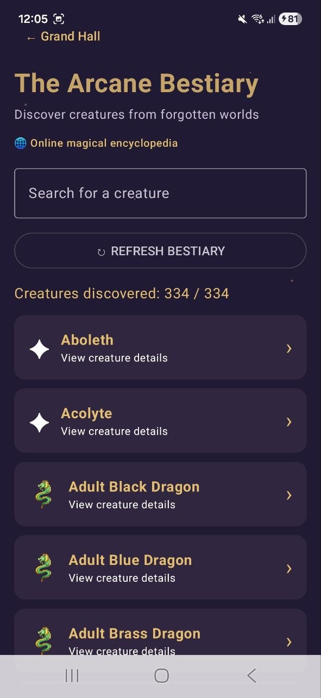
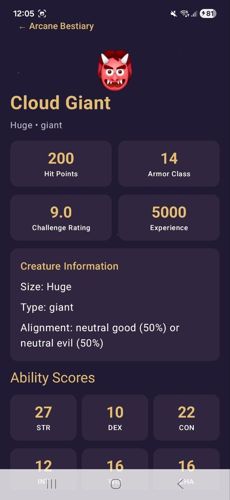
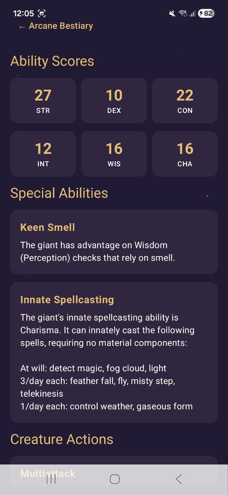
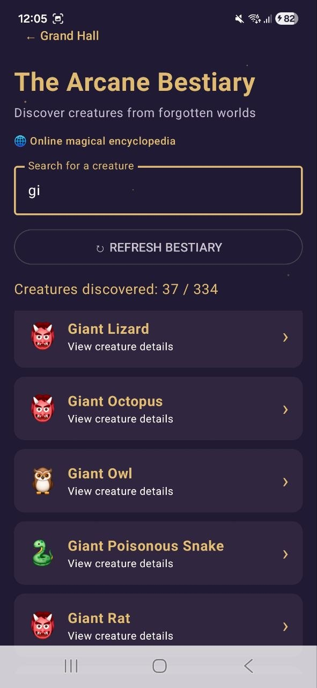
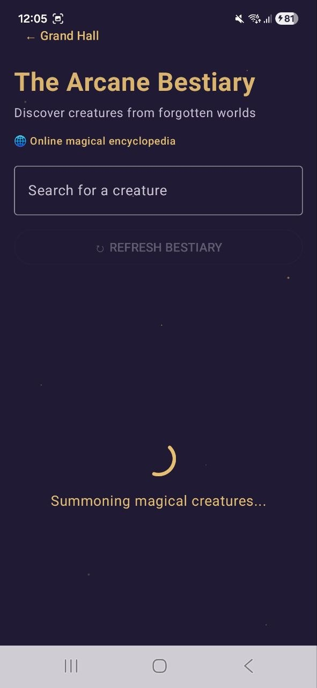
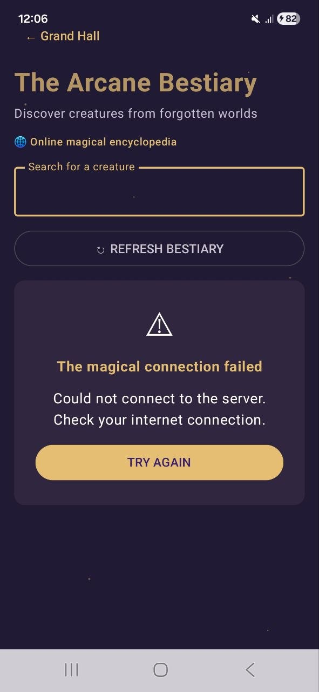

---

## 🐉 Task 4 — REST API Integration


### The Arcane Bestiary

The Arcane Bestiary is an online magical encyclopedia
integrated into Mystical Manor Adventure.

Players can discover magical creatures, explore their
characteristics, read special abilities, and learn about
their combat statistics.

All creature information is retrieved from the public
Dungeons & Dragons 5e SRD REST API using Retrofit.

### Features

| Feature | Description |
|---|---|
| Online Bestiary | Retrieves creature data from a remote REST API. |
| Creature Details | Displays hit points, armor class, challenge rating, and ability scores. |
| Special Abilities | Displays creature abilities and actions. |
| Search | Filters downloaded creatures by name. |
| Loading State | Shows a progress indicator during API requests. |
| Error Handling | Displays understandable network and server errors. |
| Retry | Allows users to repeat failed requests. |
| Refresh | Retrieves an updated creature list from the API. |
| Navigation | Connects the creature list and detail screens. |

### REST API

**API Provider:** [D&D 5e SRD API](https://www.dnd5eapi.co/)

**Base URL:**

`https://www.dnd5eapi.co/api/2014/`

| Method | Endpoint | Description |
|---|---|---|
| GET | `/monsters` | Retrieves the creature collection. |
| GET | `/monsters/{index}` | Retrieves detailed creature information. |

No API key or authentication is required.

### Architecture

The REST API integration follows the existing MVVM
architecture.

```text
Jetpack Compose UI
        |
        v
BestiaryViewModel
        |
        v
BestiaryRepository
        |
        v
Retrofit API Interface
        |
        v
OkHttp Client
        |
        v
D&D REST API
```

The API responses are converted from JSON into Kotlin
data classes using Gson.

Kotlin Coroutines provide asynchronous network
operations, while StateFlow exposes observable UI state.

Compose collects the state using
`collectAsStateWithLifecycle()`.

### UI State Management

The application uses a sealed interface to represent:

- **Idle** — the initial state.
- **Loading** — a network request is in progress.
- **Success** — API data has been received.
- **Error** — the request has failed.

The user interface reacts automatically to these states.

### Screenshots

#### Arcane Bestiary

<p align="center">
  
  
  
</p>

#### Search, Loading and Error Handling

<p align="center">
  
  
  
</p>

### Local and Remote Data Sources

Mystical Manor Adventure now combines two data sources:

| Data Source | Technology | Responsibility |
|---|---|---|
| Local | Room / SQLite | Persistent quests and activity history. |
| Remote | Retrofit / REST API | Magical creature information. |

Both features use independent repositories and
ViewModels to maintain separation of concerns.

### How to Use

1. Launch Mystical Manor Adventure.
2. Select a character and enter the Grand Hall.
3. Open the Arcane Bestiary.
4. Browse or search for magical creatures.
5. Select a creature to view its detailed information.
6. Use Refresh to request updated data.
7. If a network error occurs, use Try Again.

### Task 4 Implementation

- Kotlin data classes for JSON responses
- Retrofit REST API interface
- OkHttp network client
- Gson JSON converter
- Asynchronous requests using Coroutines
- Repository and ViewModel integration
- StateFlow and lifecycle-aware state collection
- Loading, success, error and empty states
- LazyColumn with stable item keys
- List and detail navigation
- Network error handling and retry functionality

### Data Attribution

Creature information is provided by the D&D 5e SRD API.
See the API project and its documentation for source
data and applicable licensing information.

---
