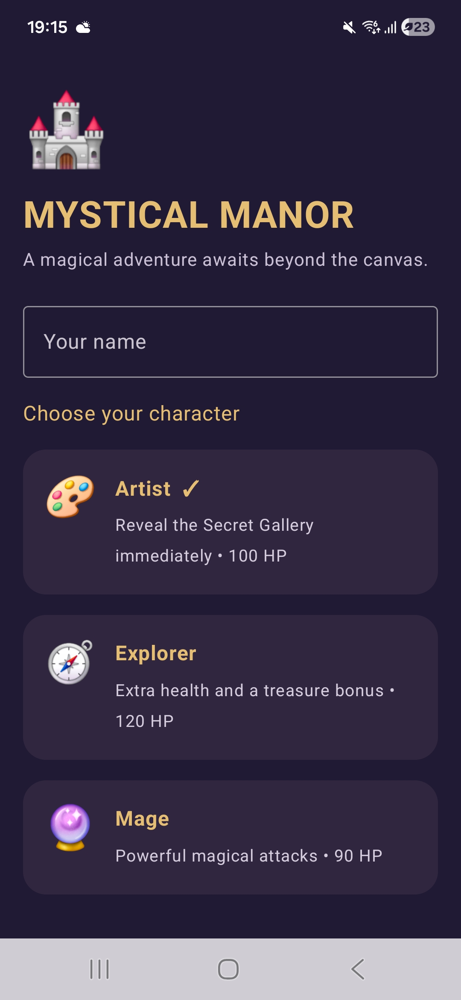
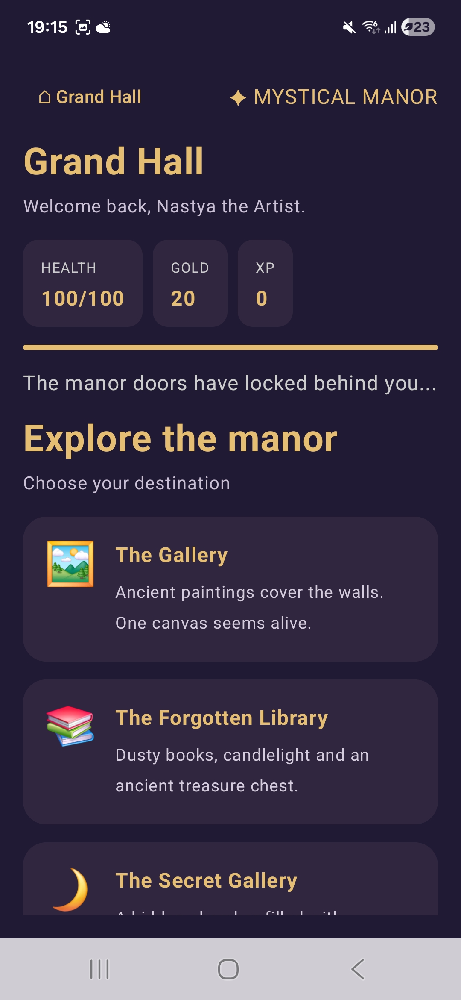
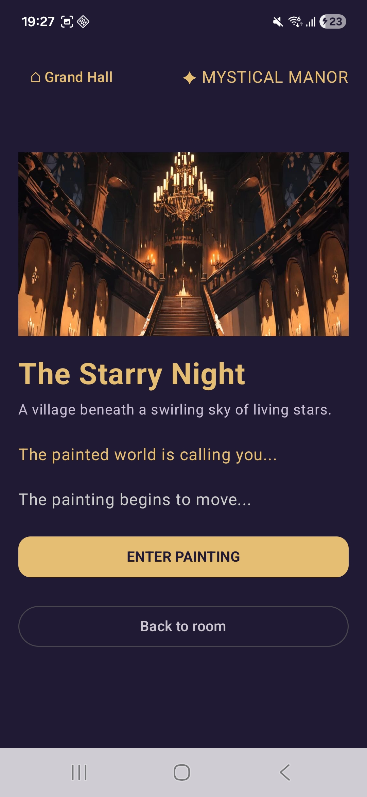
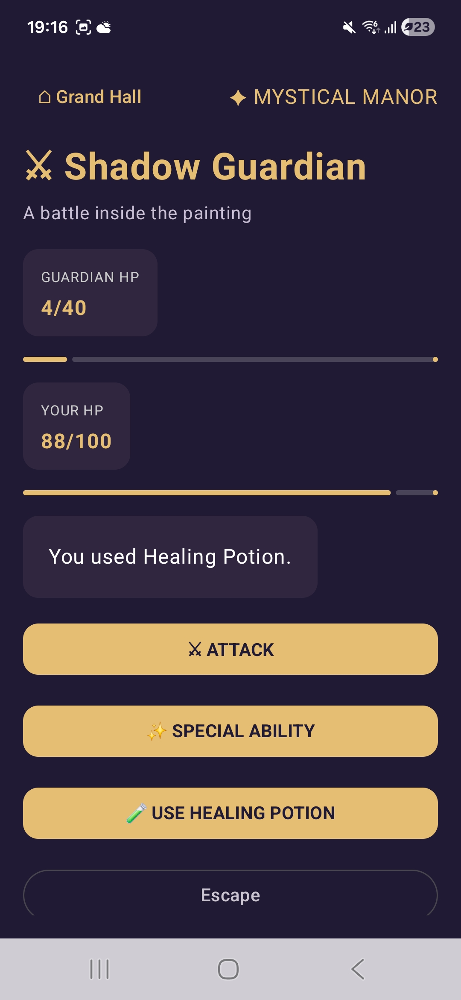
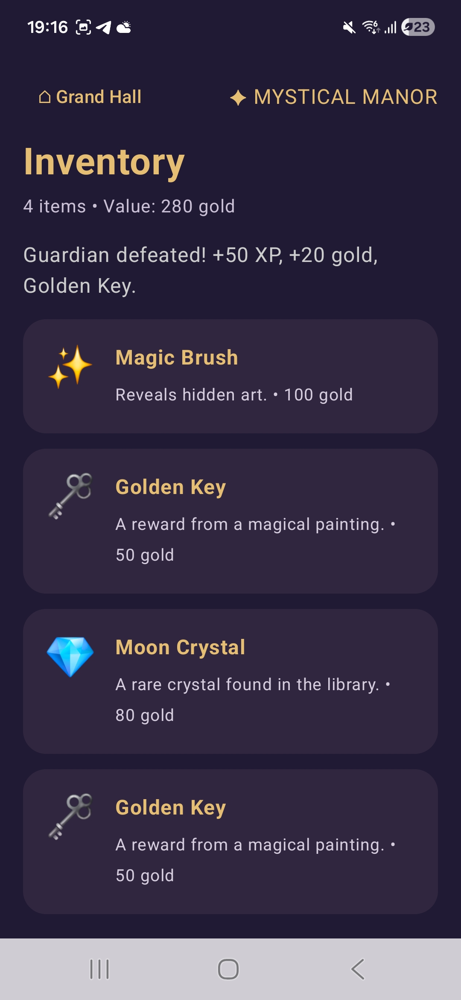
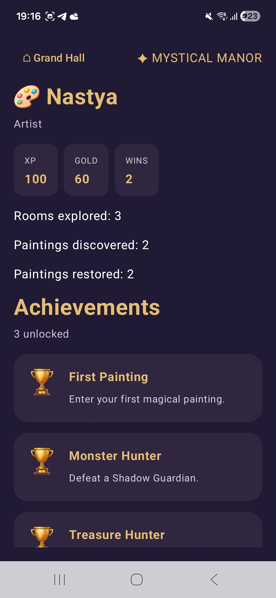

# 🏰 Mystical Manor Adventure

## ✨ About the Project

For my second Kotlin homework, I adapted my original **Mystical Manor Adventure** console game into an interactive Android application using **Jetpack Compose, Material 3, and ViewModel**.

I wanted to preserve the atmosphere and gameplay of my first project while replacing console commands with a modern mobile interface.

Players can explore mysterious rooms, discover magical paintings, collect treasures, battle Shadow Guardians, and unlock achievements.

## 🎭 Choose Your Character

Each character has different abilities and gameplay advantages.

| Character | Special Feature |
|---|---|
| 🎨 **Artist** | Uses a Magic Brush and can access the Secret Gallery immediately |
| 🧭 **Explorer** | Has additional health and receives bonus treasure rewards |
| 🔮 **Mage** | Uses powerful magical attacks |

The **Secret Gallery** is normally unlocked through exploration, but the Artist can discover it from the beginning.

## 🎮 Features

- **Character Selection** — choose a class and enter your name
- **Manor Exploration** — visit rooms and discover secret locations
- **Magical Paintings** — enter mysterious worlds
- **Turn-Based Combat** — attack, use special abilities, heal, or escape
- **Inventory System** — collect potions, crystals, and magical keys
- **Achievements** — track discoveries and victories
- **Player Statistics** — monitor health, gold, experience, and progress

## 📱 Screenshots

### Character Selection & Grand Hall

| Character Selection | Grand Hall |
|:---:|:---:|
|  |  |

### Exploration & Combat

| Room Exploration | Shadow Guardian Battle |
|:---:|:---:|
|  |  |

### Inventory & Achievements

| Inventory | Player Profile |
|:---:|:---:|
|  |  |

## 🛠 Technologies & Architecture

| Technology | Purpose |
|---|---|
| **Kotlin** | Application and game logic |
| **Jetpack Compose** | Declarative user interface |
| **Material 3** | UI components and styling |
| **ViewModel** | Game state and application logic |
| **StateFlow** | Reactive state updates |
| **remember** | Temporary UI state |
| **rememberSaveable** | Saveable local UI state |

I separated my application into three main layers:

- `model/` — characters, items, rooms, paintings, and game state
- `viewmodel/` — gameplay logic, navigation, and state updates
- `ui/` — screens and reusable Compose components

I also created reusable components such as `ManorCard`, `ManorButton`, `ManorTitle`, and `StatChip`.

The application uses `Row`, `Column`, `Box`, `LazyColumn`, `Card`, `Image`, `TextField`, `Checkbox`, and other Compose components.

### State Management

I use `ViewModel` with `StateFlow` to manage the player's progress and update the interface after actions.

I also use `remember` for temporary UI state and `rememberSaveable` for local state that should survive Activity recreation.

This allows me to demonstrate how game state behaves when the device rotates.

## ▶️ How to Run

1. Clone or download this repository.
2. Open the **`android-app`** folder in Android Studio.
3. Wait for Gradle synchronization.
4. Connect an Android device with USB debugging enabled or start an emulator.
5. Select the `app` configuration and click **Run ▶**.

**Requirements:** Android Studio, Android SDK, and an Android device or emulator with API 26+.

---

*Created as my second Kotlin homework, continuing the original Mystical Manor Adventure project and exploring modern Android development with Jetpack Compose and ViewModel.*
